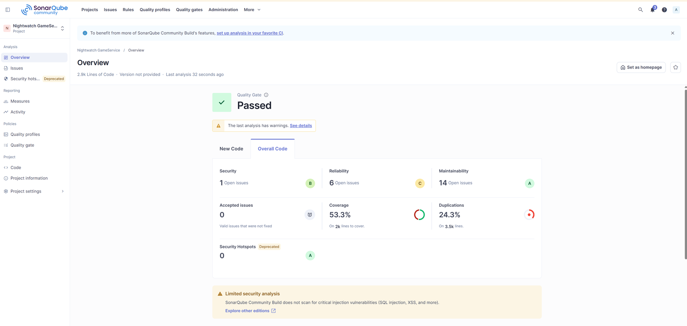

# 🎮 NP-GameService

[](https://github.com/JuanDeRe/NP-GameService/actions/workflows/ci.yml)

The **authoritative game server** of [Nightwatch Protocol](https://github.com/Nightwatch-Protocol/nightwatch-protocol). It owns the official state of every match; clients only send intentions.

## What it does
- Hosts **multiple concurrent matches** per instance (in-memory sessions, per-match locking)
- **Movement:** normalizes direction, applies server-side speed (faster once empowered), checks the walkable map **axis by axis** (sliding along walls) and blocks movement through closed doors. The guard cannot move
- **Doors:** only the guard can open/close; a door cannot close while an animatronic is inside it
- **Cameras:** only the guard can switch the active camera; sabotaged cameras are rejected
- **Collectibles:** each animatronic has its own items to collect; after 5 it becomes **empowered**
- **Map:** a code-defined tile map with rooms, hallways, spawn, attack and power-up zones
- **Match timer:** a background processor ends matches when the duration expires, and the guard wins
- **Match lifecycle events:** results go to a **Redis Stream** consumed by Matchmaking and the Gateway
- **Capacity heartbeat:** registers itself in Redis so Matchmaking can place new matches; integrates with the EC2 Auto Scaling group
- **CloudWatch metrics** and `/health`

## What was achieved
A consistent, synchronized world for all players: positions, doors, item pickups and cameras are decided here and broadcast through the Gateway. Instances can be added behind Matchmaking to host more simultaneous matches.

## Tech stack
C# · .NET 9 · ASP.NET Core · Redis · AWS SDK (CloudWatch, Auto Scaling) · Docker · xUnit · GitHub Actions

## Run locally
```bash
docker run -p 6379:6379 redis
dotnet run     # http://localhost:5002
dotnet test
```
Config: `Redis__ConnectionString`, `GameService__InstanceId`, `GameService__MaxMatches`, `GameSettings__MatchDurationSeconds`.

## Design
- **Factory:** `GameSessionFactory` builds consistent matches (roles, spawn points, collectibles, doors, cameras)
- **Repository:** `IGameSessionStore` abstracts match storage (in-memory today)
- **Dependency inversion:** movement, door, camera, map and lifecycle services behind interfaces
- **Background workers:** match expiration and capacity heartbeat

## Code quality
Analyzed with **SonarQube Community**: quality gate **passed**, 2.9k lines of code, **53.3% coverage** on 2k coverable lines, **24.3% duplication**.



## Tests
xUnit tests for movement: valid moves, axis blocking, guard immobility and unknown matches.

## Notes / limitations
- Match state is in memory: restarting an instance loses its active matches.
- Battery, flash, shock, camera sabotage and the animatronic special abilities exist only as model fields; they are not implemented.
- `POST /game/matches/{id}/finish` ends a match with a given winner; automatic detection of an animatronic reaching the office is <!-- VERIFY: not found in main -->.
- Internal endpoints are unauthenticated and rely on network isolation (security groups).

## Part of Nightwatch Protocol
[Main repo](https://github.com/Nightwatch-Protocol/nightwatch-protocol) · [Unity Client](https://github.com/JuanDeRe/Nightwatch-Protocol-Unity-Client) · [Auth](https://github.com/JuanDeRe/NP-AuthService) · [Matchmaking](https://github.com/JuanDeRe/NP-MatchmakingService) · [Gateway](https://github.com/JuanDeRe/NP-RealtimeGateway) · **Game Service** · [Terraform](https://github.com/JuanDeRe/NP-Terraform)
